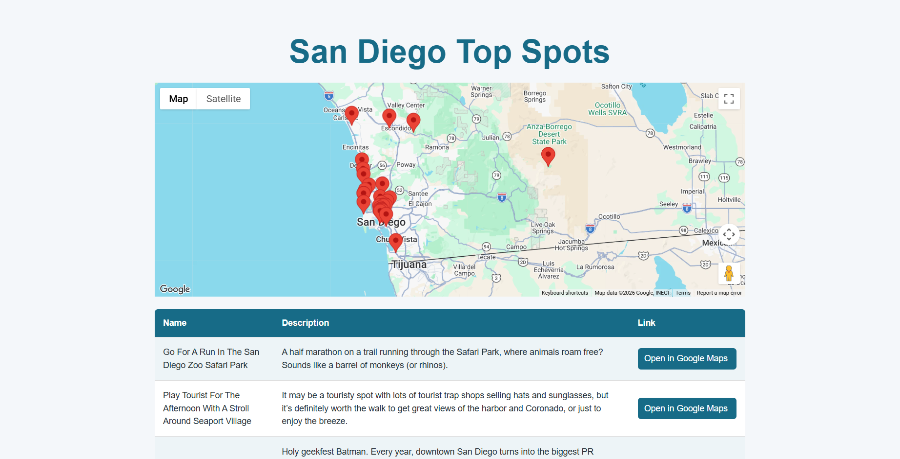
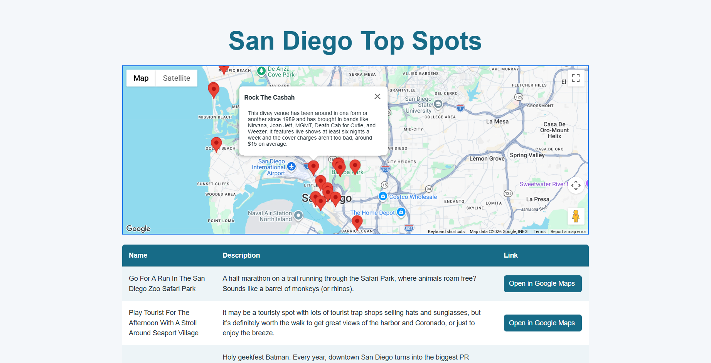

# San Diego Top Spots

A Node.js and Express web app for exploring 30 San Diego destinations. Browse location descriptions, find each spot on an interactive map, and open its coordinates in Google Maps.

This is a Creating Coding Careers Apprenticeship project used to learn how to set up an express server. I realized while working on it that I could easily use this server to run my San Diego Top Spots project that I had built earlier while learning HTML CSS and vanill JavaScript. I combined the projects and it works very well!

I implemented the map and list with buttons as well as the server, the data and tests are from the Creating Coding Careers project. AI did not generate any of the code but did write most of the README markdown file below.

The project demonstrates how an Express server, a JSON endpoint, and a JavaScript frontend work together to turn a local dataset into an interactive browser experience.

## Screenshots





## Features

- **Location directory:** A table of destination names, descriptions, and Google Maps links, populated from the server.
- **Interactive map:** Google Maps advanced markers with clickable location details and a viewport that fits all destinations.
- **JSON endpoint:** `GET /data` serves the same location dataset used by both the table and the map.
- **Request logging:** Morgan logs incoming HTTP requests during development.
- **API tests:** Mocha, Chai, and Chai HTTP verify the homepage response and location data.

## Tech stack

| Layer | Technologies |
| --- | --- |
| Server | Node.js, Express 4, Morgan |
| Frontend | HTML, CSS, JavaScript, jQuery 3.7.1 |
| Maps | Google Maps JavaScript API, Advanced Markers |
| Data | Local JSON file |
| Testing | Mocha, Chai, Chai HTTP |

## Run locally

Install Node.js and npm. The server tests have been verified with Node.js 24.21.0 and npm 11.19.0.

```bash
git clone https://github.com/jakefred/Express-Server.git
cd Express-Server
npm ci --include=dev
npm start
```

Open [http://localhost:3000](http://localhost:3000). The server uses port `3000`, configured in `server/index.js`; no build step or database setup is required.

Development dependencies are included explicitly because Express is currently listed under `devDependencies` in `package.json`.

### Google Maps setup

To run the embedded map with your own Google Maps credentials:

1. Follow Google's [Maps JavaScript API setup guide](https://developers.google.com/maps/documentation/javascript/get-api-key) to create a key and enable the API. A standard API key requires a Google Cloud project with billing enabled.
2. In `server/index.html`, replace the existing `key` value in the Google Maps script URL with your key, keeping the other query parameters:

   ```text
   https://maps.googleapis.com/maps/api/js?key=YOUR_API_KEY&loading=async&libraries=marker&callback=initMap
   ```

3. Restrict the key to your website origins and the Maps JavaScript API, allowing `http://localhost:3000/*` for local development.

The key is loaded directly in the HTML; the app does not currently read it from an environment variable. The browser also needs internet access to load Google Maps and jQuery from their hosted scripts. The location table and `/data` endpoint do not require Google Maps credentials.

## How it works

1. Express serves the homepage, stylesheet, and browser JavaScript.
2. The frontend requests `/data` and builds table rows from the returned locations.
3. Once Google Maps loads, the map also requests `/data`, creates a marker for each location, and adjusts its bounds to show every marker.
4. Clicking a marker opens the location's name and description in a shared info window. Table links open the corresponding coordinates in Google Maps.

The Express application is defined separately from the server's listening entry point, allowing the tests to import the app without starting it on port `3000`. Location names and descriptions are inserted using `.text()` or `textContent` so they are rendered as text.

## API

| Method | Route | Response |
| --- | --- | --- |
| `GET` | `/` | HTML homepage |
| `GET` | `/data` | JSON array of all 30 locations |
| `GET` | `/style.css` | Frontend stylesheet |
| `GET` | `/main.js` | Frontend JavaScript |

Each object returned by `/data` has this shape:

```json
{
  "name": "Go For A Run In The San Diego Zoo Safari Park",
  "description": "A half marathon on a trail running through the Safari Park, where animals roam free? Sounds like a barrel of monkeys (or rhinos).",
  "location": [33.09745, -116.99572]
}
```

Coordinates are ordered as `[latitude, longitude]`. Data is stored in `server/data.json`; restart the server after editing that file to reload it. This is a static destination dataset, so descriptions are not live venue or event information.

## Tests

```bash
npm test
```

The existing suite checks that:

- `GET /` returns HTTP `200` and HTML.
- `GET /data` returns HTTP `200` and exactly matches the local dataset.

Tests run against the imported Express app and do not require a separately running server or a Google Maps key. Browser rendering and map interactions are not covered by the current suite.

## Project structure

```text
server/
  app.js          Express routes and request logging
  index.js        Server entry point (port 3000)
  data.json       Destination names, descriptions, and coordinates
  index.html      Homepage and external script loading
  main.js         Table rendering and Google Maps interactions
  style.css       Page, table, and map popup styles
test/
  server.spec.js  HTTP endpoint tests
package.json      Dependencies and npm scripts
package-lock.json Locked dependency versions
```
